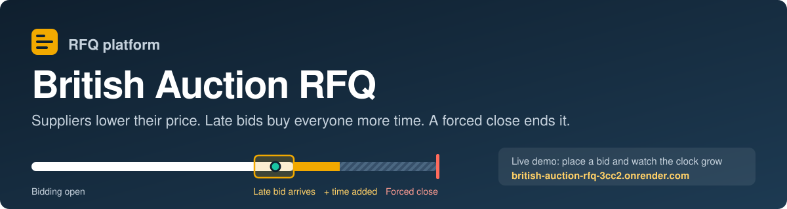
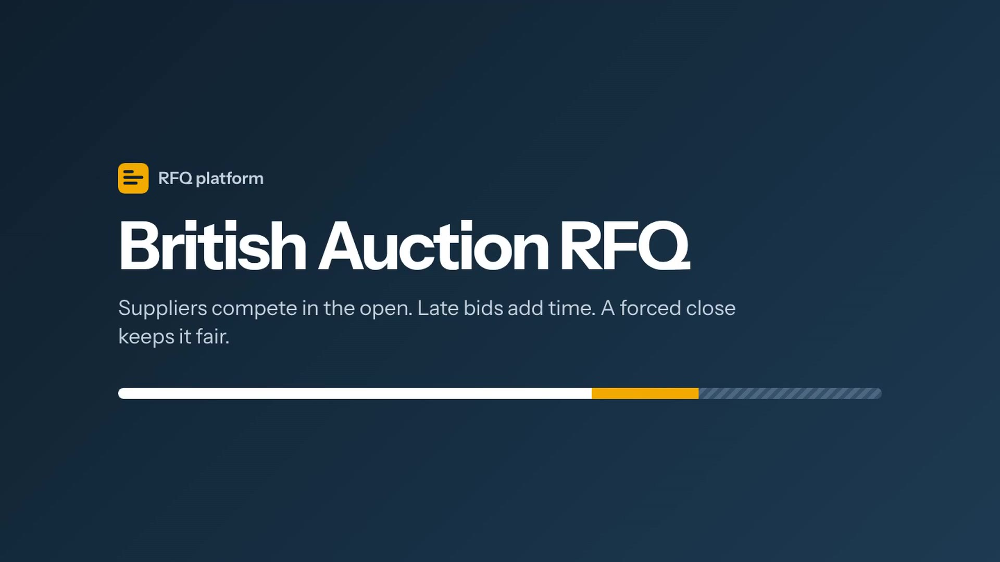
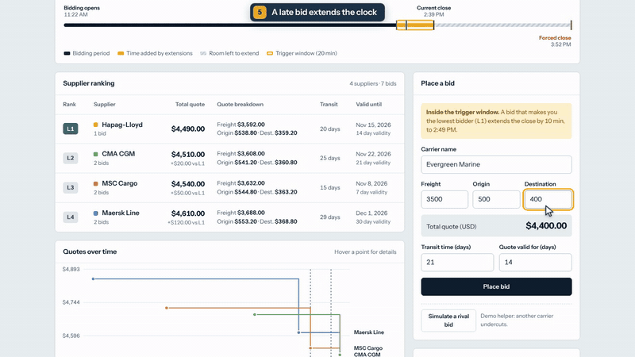
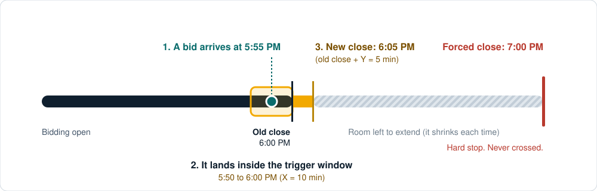
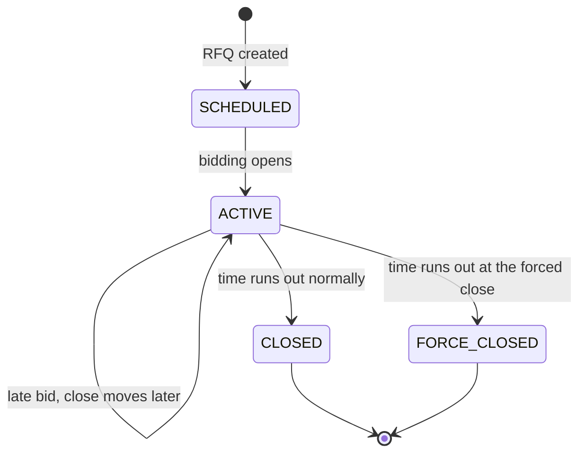
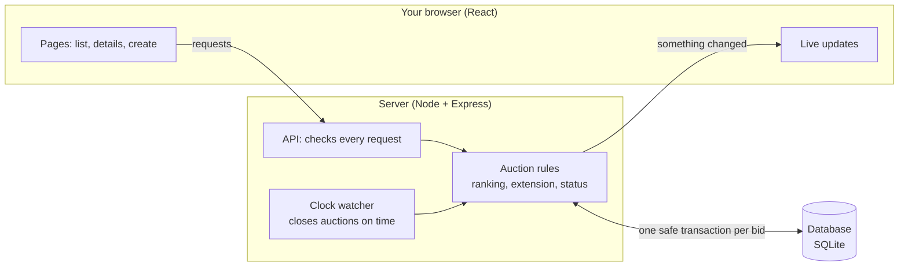
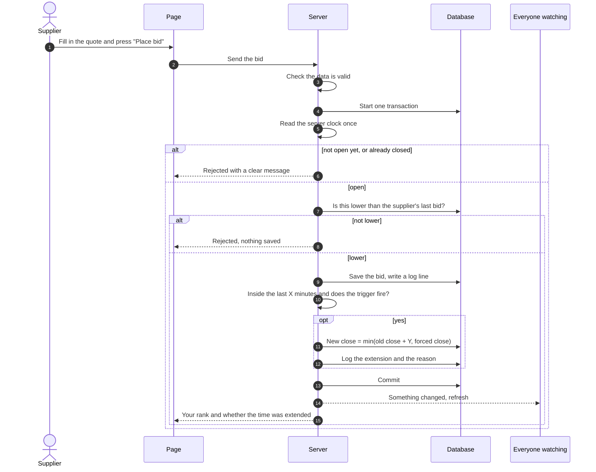

<div align="center">



**A freight-quote platform where suppliers compete in the open, late bids add extra time, and a hard stop keeps the auction fair.**

[](https://british-auction-rfq-3cc2.onrender.com)
[](https://github.com/abhishekisagemai-bot/britishrfq/actions)
[](#how-it-was-checked)
[](#the-tech)
[](LICENSE)

### 👉 **Live app: [british-auction-rfq-3cc2.onrender.com](https://british-auction-rfq-3cc2.onrender.com)**

<sub>It runs on Render's free plan, so if nobody has used it for a while the first load can take 30 to 60 seconds. Just wait; it is waking up.</sub>

</div>

## Contents

1. [The 30-second version](#the-30-second-version)
2. [Try the live app](#try-the-live-app)
3. [Demo video and pitch](#demo-video-and-pitch)
4. [What it looks like](#what-it-looks-like)
5. [How a British auction works](#how-a-british-auction-works)
6. [How the system is built](#how-the-system-is-built)
7. [What happens when someone places a bid](#what-happens-when-someone-places-a-bid)
8. [The three pages](#the-three-pages)
9. [The rules that are checked](#the-rules-that-are-checked)
10. [Does it cover the assignment?](#does-it-cover-the-assignment)
11. [How it was checked](#how-it-was-checked)
12. [What went wrong first](#what-went-wrong-first)
13. [Choices I made where the brief was silent](#choices-i-made-where-the-brief-was-silent)
14. [Run it on your computer](#run-it-on-your-computer)
15. [Deploy it yourself](#deploy-it-yourself)
16. [Project layout](#project-layout)
17. [Limitations](#limitations)

##  The 30-second version

A company that ships goods (the **buyer**) needs a price for moving a container. Instead of calling carriers one by one, it publishes a **Request for Quotation (RFQ)**. Carriers (the **suppliers**) then bid against each other, openly, and the buyer ends up with a better price.

This project runs that process as a **British auction**:

- **Everyone sees every bid.** Suppliers are ranked by price: the cheapest is **L1**, the next is **L2**, and so on.
- **A supplier can only lower its own price.** You cannot raise a quote or repeat it.
- **Late bids add time.** If something happens in the last few minutes, the auction is extended. This stops people from sneaking in a bid at the very last second.
- **There is a hard stop.** A **Forced Bid Close** time is the absolute end. No extension can ever go past it.

**Words you will see in this README**

| Word | Plain meaning |
| --- | --- |
| **RFQ** | A request for price quotes. In this app, one RFQ is one auction. |
| **Supplier / carrier** | A company that bids to move the goods. |
| **Bid / quote** | A supplier's offer: freight charge + origin charge + destination charge. |
| **L1, L2, L3** | The ranking. L1 is the lowest (best) price. |
| **Bid Close** | When bidding is scheduled to end. This can move later if the auction is extended. |
| **Forced Bid Close** | The final deadline. It never moves and nothing can go past it. |
| **X (trigger window)** | How many minutes before the close we watch for activity. Example: X = 10 means "the last 10 minutes". |
| **Y (extension)** | How many minutes are added when the rule fires. Example: Y = 5 means "add 5 minutes". |

##  Try the live app

Open **<https://british-auction-rfq-3cc2.onrender.com>**. Seven demo auctions are already there, so you can explore without creating anything.

**See the main idea in about 20 seconds:**

1. On the home page, open **"Mumbai (JNPT) → Rotterdam"**. It is live and already inside its "last X minutes" window.
2. Look at the big countdown at the top and the amber **"Trigger window open"** tag.
3. Click **Simulate a rival bid** (or fill the form with a price below the current L1).
4. Watch what changes without refreshing the page:
   - the countdown jumps up by Y minutes,
   - the amber part of the timeline strip grows,
   - a new line appears in the **Activity log** that says *why* the time was extended.

**Other things worth clicking**

- **"Nhava Sheva → Felixstowe"** is a **Force closed** auction. Its log shows an extension that was cut short, and a later one that was refused.
- **New RFQ** lets you create your own auction. Try setting the forced close earlier than the bid close and see the error.
- On the home page, the strip at the top compares auctions that were extended with ones that were not.

##  Demo video and pitch

[](docs/demo/demo.mp4)

**[▶ Watch the demo video](docs/demo/demo.mp4)** (3:43, 1080p, no sound). It is a real recording of the live app: nothing is faked or edited together. It has short chapter labels at the top so you always know what part you are watching.



<sub>The moment a late bid extends the auction: the countdown jumps, the timeline grows, and the log says why.</sub>

| Time | Chapter | What you see |
| --- | --- | --- |
| 0:00 | Intro | The idea in one line |
| 0:11 | The idea | The auction list: lowest bid, close time, status |
| 0:38 | Is it working? | Bids per RFQ and the price won in extra time |
| 0:51 | Create an RFQ | The form, a rule error on purpose, the live timeline preview |
| 1:30 | A live auction | Countdown, timeline, ranking L1 to L4, price chart |
| 1:59 | A late bid extends the clock | A real bid inside the trigger window, +10 minutes, with the reason |
| 2:24 | Not every bid extends | A bid that improves a rank but does not change L1: no extension |
| 2:43 | The rules are enforced | A supplier tries to raise its price and is rejected |
| 2:57 | The forced close | An auction that hit its hard stop: one extension cut short, one refused |
| 3:24 | Wrap-up | Tests, accessibility, security, and the links |

**Want to present it yourself?** There is no AI voice on purpose. [`docs/demo/VOICEOVER.md`](docs/demo/VOICEOVER.md) has:

- the exact words to say in each scene, with the second it starts,
- what is on screen at the same moment,
- a 30-second and a 60-second version of the pitch,
- 12 questions people usually ask, each with a short answer,
- the one command that puts your voice on the video.

The video is made by a script, so it can be recorded again after any change: see the end of that page.

##  What it looks like


<table>
<tr>
<td width="50%"></td>
<td width="50%"></td>
</tr>
<tr>
<td align="center"><sub>All auctions: status, lowest bid, close times</sub></td>
<td align="center"><sub>Create an RFQ, with a live preview of the timeline</sub></td>
</tr>
</table>

##  How a British auction works

### The key idea, in one picture



Read it left to right:

1. The auction is scheduled to close at **6:00 PM**.
2. The system watches the last **X = 10 minutes** (5:50 to 6:00 PM). This is the **trigger window**.
3. A bid arrives at **5:55 PM**. That is inside the window, so the rule fires.
4. The close moves from 6:00 PM to **6:05 PM** (the old close plus **Y = 5 minutes**).
5. Everyone else now has 5 more minutes to answer. If another bid lands in the new last 10 minutes, the close moves again.
6. This can repeat, but the close can **never** go past the **Forced Bid Close** at 7:00 PM.

### A worked example

Settings: close **6:00 PM**, forced close **7:00 PM**, X = 10 min, Y = 5 min, trigger = "any bid".

| Time | What happens | Close time after | Why |
| --- | --- | --- | --- |
| 5:30 PM | Maersk bids $4,850 | 6:00 PM | Too early. It is outside the last 10 minutes. |
| 5:49 PM | MSC bids $4,700 | 6:00 PM | Still outside the window (it starts at 5:50). |
| 5:55 PM | CMA CGM bids $4,600 | **6:05 PM** | Inside the window. Extended by 5 minutes. |
| 6:03 PM | Maersk bids $4,500 | **6:10 PM** | The window is now 5:55 to 6:05. Extended again. |
| 6:10 PM | Anyone tries to bid | closed | A bid at exactly the close time is rejected. |

If the forced close were only 6:08 PM, the 6:03 PM bid would move the close to **6:08 PM** (not 6:10) and the auction would end as **Force closed**.

### Three ways to decide "what counts as activity"

When you create an RFQ you choose one trigger. All three only matter **inside the last X minutes**.

| Trigger | The auction is extended when... | Example |
| --- | --- | --- |
| **Bid received** | any new bid arrives | A supplier lowers its price by $1. Extended. |
| **Any rank change** | the order of suppliers changes (someone moves up, or a new supplier joins the ranking) | B (L2) underbids A (L1) and becomes L1. Extended. But if A just lowers its own price and stays L1, nothing changes. |
| **L1 change** | a different supplier becomes the lowest bidder | C becomes the new L1. Extended. If L2 and L3 swap places, not extended. |

### The four states of an auction



| Status | What it means |
| --- | --- |
| **Scheduled** | The auction exists but bidding has not opened yet. |
| **Active** | Bidding is open. |
| **Closed** | Bidding ended at a normal close time. |
| **Force closed** | Extensions pushed the close all the way to the Forced Bid Close, and the auction ended there. |

##  How the system is built



| Part | Job | Where |
| --- | --- | --- |
| **Pages** | Show auctions, ranking, chart and logs. Send new RFQs and bids. | `frontend/src` |
| **API** | Receives requests, checks the data, returns clear errors. | `backend/src/http` |
| **Auction rules** | The "brain": who is L1, whether to extend, what the status is. Written as small pure functions so they are easy to test. | `backend/src/domain` |
| **Service** | Puts the steps in order and saves everything in one safe transaction. | `backend/src/service.ts` |
| **Clock watcher** | Every second, moves auctions from Scheduled to Active to Closed on time, even if nobody is using the site. | `backend/src/server.ts` |
| **Database** | Stores RFQs, suppliers, bids and the activity log. | `backend/db/schema.sql` |
| **Live updates** | When a bid arrives, the server tells every open page, so nobody needs to refresh. | Server-Sent Events |

### Three design ideas that matter

- **Only the server keeps time.** Your laptop clock could be wrong, so the server stamps every bid. The countdown on the page is corrected using the server's time.
- **A bid is all-or-nothing.** Checking, saving, ranking, extending and logging happen in one transaction. A rejected bid leaves no trace, and two bids at the same moment cannot corrupt each other.
- **Ranking is calculated, never stored.** L1, L2 and L3 are worked out from the bids every time, so they can never be out of date.

### The tech

| Area | Choice | Why |
| --- | --- | --- |
| Frontend | React 18, TypeScript, Vite | Fast, typed, easy to test |
| Backend | Node 22, Express 5, TypeScript | Same language on both sides |
| Database | SQLite (built into Node 22, WAL mode) | No extra server to install |
| Validation | Zod | One place that defines what a valid request looks like |
| Live updates | Server-Sent Events | Simple push from server to browser |
| Tests | Vitest, React Testing Library, axe-core | Rules, screens and accessibility |
| Hosting | Render (free plan) | Deploys automatically on every push |

##  What happens when someone places a bid



In plain words, the steps are:

1. **Validate.** Are all fields present and sensible? (Money has at most 2 decimals, transit time is a whole number of days, and so on.)
2. **Check the time.** Bids before the start or at/after the close are rejected.
3. **Check it is lower.** A supplier's new total must be lower than its own previous total.
4. **Save** the bid and write a line in the activity log.
5. **Work out the new ranking** and compare it with the old one.
6. **Decide on an extension.** Inside the last X minutes? Does the chosen trigger fire? If yes, add Y minutes but never beyond the forced close.
7. **Tell everyone** watching the page.

##  The three pages

| Page | What you can do and see |
| --- | --- |
| **Auction list** (`/`) | Every auction with its name and ID, **current lowest bid**, **current bid close**, **forced close** and **status**. Filter by status, search by name, and see a live "time left". A strip at the top compares extended and non-extended auctions (bids per RFQ and price improvement). |
| **Auction details** (`/auctions/<id>`) | A big countdown and a **timeline strip** showing the original close, time added, the trigger window and the forced close. The **ranking** (L1, L2, L3...) with the full quote (freight, origin, destination, transit time, validity). A **price chart** over time. **All bids sorted by price.** The **configuration** (X, Y and the trigger). A bid form. And the **activity log**: every bid, every extension, and the reason for each one. |
| **New RFQ** (`/new`) | RFQ name/ID, bid start, bid close, forced bid close, pickup date, X, Y and the trigger. A live preview of the timeline, and clear errors if something is wrong. |

##  The rules that are checked

| Rule | Where it is enforced |
| --- | --- |
| Forced close must be **later** than bid close | The form, the server, **and** the database |
| An extension can never go **past** the forced close | The rules code **and** a database constraint |
| Bid close must be after bid start and in the future | The form and the server |
| The trigger window X cannot be longer than the bidding period | The form and the server |
| Dates must include a time zone (no guessing) | The server |
| A supplier's new bid must be lower than its own last bid | The server |
| No bids before the start or at/after the close | The server |
| An RFQ reference ID must be unique | The server and the database |
| Money has at most 2 decimals and is stored as whole cents (no rounding errors) | The server and the database |
| Too many writes from one place are slowed down | The server |

##  Does it cover the assignment?

Yes. This table maps each line of the brief to the code and the check that proves it.

| Brief | What was built | Proved by |
| --- | --- | --- |
| Create an RFQ with the British Auction option | Create page and `POST /api/auctions` | REST tests, UI tests |
| Fields: name/ID, start, close, **forced close**, pickup date | All present, with validation | Service tests |
| Quote form: carrier, freight, origin, destination, transit time, validity | The bid form, with a live total | Service and UI tests |
| Never extend beyond the forced close | Clamped in code, plus a database constraint | 200-case property test, live end-to-end run |
| **X** minutes: the trigger window | `[close - X, close)` | Boundary tests (5:50 in, 5:49:59 out, 6:00 out) |
| **Y** minutes: the extension | Added to the current close (6:00 to 6:05) | The brief's own example, as a test |
| Trigger: bid received in last X min | `BID_RECEIVED` | Test and live run |
| Trigger: any rank change in last X min | `ANY_RANK_CHANGE` | Test and live run |
| Trigger: L1 change in last X min | `L1_CHANGE` | Test and live run |
| Forced close later than bid close | Form, server and database | Unit, service and UI tests |
| Listing page: name/ID, lowest bid, current close, forced close, status | The auction list | REST tests |
| Details page: all bids by price, L1/L2/L3, quote details, X and Y | The details page | Service and UI tests |
| Activity log: bids, extensions and **why** | The activity log | Tests for each trigger's reason text |
| Success metrics: bids per RFQ, better prices | The comparison strip on the list page | Service test |
| **Deliverables:** HLD with diagram, schema, backend, frontend | [`docs/HLD.md`](docs/HLD.md), [`docs/SCHEMA.md`](docs/SCHEMA.md), `backend/`, `frontend/` | You are reading it |

More detail: [`docs/HLD.md`](docs/HLD.md) (architecture and trade-offs), [`docs/SCHEMA.md`](docs/SCHEMA.md) (database, with a diagram), [`docs/API.md`](docs/API.md) (every endpoint).

##  How it was checked

| Check | Result |
| --- | --- |
| Backend tests: rules to the millisecond, services, REST API, scale | **42 passing** |
| Frontend tests: timeline, ranking table, activity log, chart, bid form, list, create form | **18 passing** |
| **Real-clock end-to-end run** (`npm run e2e`): creates auctions that really run for about 3.5 minutes and checks all three triggers, the cap, a refused extension, a force close, and the list and detail pages | **39 of 39 checks pass** |
| Accessibility scan (axe, WCAG 2.1 A and AA) on every page, desktop and phone | **0 violations** |
| Dependency security audit (`npm audit`) | **0 vulnerabilities** |
| Continuous integration on GitHub (typecheck, tests, build) | Green |
| Speed: one bid when an auction already has 3,000 bids | about **13 ms** |
| Page data size with 3,000 bids | about **330 KB** (it was 1.5 MB before it was capped) |
| Hard inputs: 60 bids at once, strange numbers, SQL and HTML in names | All handled correctly |
| Demo video (`scripts/demo`): a real browser, real clock, recorded in one take | 3:43, 1080p |

The end-to-end script is worth a look: it does not fake the clock. It starts real auctions with short windows and waits, so it proves the extensions work in real time.

##  What went wrong first

Honest list of the problems found while checking the work, and what was done.

| What was found | What it taught | Fix |
| --- | --- | --- |
| Every bid re-ranked **all** bids. At 3,000 bids a single bid took about 50 ms. | Work should grow with the number of suppliers, not the number of bids. | Ranking now reads only each supplier's best bid. About 4 times faster. |
| The details page sent every bid. At 3,000 bids that was 1.5 MB. | A busy auction must not slow the page down. | The table shows 200 rows with a "Show all" button. The chart still gets the full history. |
| A very large request body returned a server error (500). | Bad input from a client should never look like a server crash. | It now returns a clear 413. |
| A broken URL like `/api/auctions/%E0%A4%A` also gave a 500. | Same lesson. | It now returns 400 with a JSON message. |
| Light grey helper text had too little contrast (4.1:1, the minimum is 4.5:1). | Looks fine to the author, hard to read for others. | Darker grey (5.9:1). |
| The scrolling activity log could not be reached with a keyboard. | An accessibility scan finds what the eye misses. | It can now be focused and scrolled with the keyboard. |
| Some package versions had security advisories. | Dependencies age. | Upgraded zod, vitest and react-router. The audit is now clean. |
| Chart lines were told apart by colour only. | Colour alone is not enough. | Added dashed patterns and a legend. |

##  Choices I made where the brief was silent

The brief leaves some details open. These are the decisions, so nothing is hidden.

| Question | Choice |
| --- | --- |
| What is the difference between **Closed** and **Force closed**? | Force closed means the auction ended exactly at the forced close time. Otherwise it is Closed. |
| Is the extension added to the old close or to "now"? | To the **old close** (6:00 to 6:05), exactly like the brief's example. |
| Is the window's end inclusive? | No. The window is "from X minutes before the close, up to but not including the close". A bid at exactly the close is rejected. |
| What is a "rank change"? | The order of suppliers changes: someone moves up, or a new supplier joins. A price drop that keeps everyone's place is not a rank change. |
| Does the first bid count as an L1 change? | Yes. Nobody was L1 before, now someone is. |
| Can a supplier raise its price? | No. A new total must be lower than that supplier's own last total. |
| What if two suppliers have the same price? | The earlier bid ranks higher. |
| What unit are transit time and quote validity? | Days. |
| Logins? | Not part of the brief. Suppliers are identified by the carrier name they type. See [Limitations](#limitations). |

If your reading of the brief is different, each of these rules lives in one small file (`backend/src/domain`) and is easy to change.

##  Run it on your computer

You need **Node 22.13 or newer**. Nothing else (no database server).

```bash
git clone https://github.com/abhishekisagemai-bot/britishrfq.git
cd britishrfq
npm install
npm run dev
```

Then open **<http://localhost:5173>**. The first start creates 7 demo auctions for you.

| Command | What it does |
| --- | --- |
| `npm run dev` | Starts the API on port 8080 and the website on port 5173, with auto-reload |
| `npm test` | Runs all 60 tests |
| `npm run typecheck` | Checks the TypeScript types |
| `npm run build` | Builds everything for production |
| `npm start` | Runs the production build on <http://localhost:8080> (API and website together) |
| `npm run seed` | Resets the demo data |
| `npm run e2e` | The real-time end-to-end check (about 3.5 minutes). Use `BASE=https://your-url npm run e2e` to test a deployed copy |
| `docker compose up --build` | Runs it in a container |

**Settings** (environment variables, all optional)

| Name | Default | Meaning |
| --- | --- | --- |
| `PORT` | `8080` | Port the server listens on |
| `DB_PATH` | `backend/data/rfq.db` | Where the SQLite file lives |
| `ENABLE_DEMO` | on outside production | Adds the demo auctions and the "Simulate a rival bid" button |
| `WEB_DIR` | `frontend/dist` | Folder with the built website |

##  Deploy it yourself

This repository includes a [`render.yaml`](render.yaml), so deploying to [Render](https://render.com) takes a few clicks:

1. Fork or use this repository.
2. In Render, choose **New**, then **Blueprint**, and pick the repository.
3. Press **Apply**. Render builds and starts it. The health check is `/api/health`.

Every push to `main` redeploys automatically. On the free plan the data resets when the service restarts. Demo auctions are created again at each start. On a paid plan, attach a disk and set `DB_PATH=/var/data/rfq.db`.

##  Project layout

```text
backend/
  src/domain/       the auction rules (ranking, extension, status, validation)
  src/service.ts    the steps for creating RFQs and placing bids
  src/http/         the API and the live-update stream
  src/seed.ts       demo data, built through the real code paths
  db/schema.sql     the database tables and constraints
  test/             backend tests
frontend/
  src/pages/        list, details, create
  src/components/   timeline, ranking table, chart, bid form, activity log
  src/test/         component tests
docs/               HLD, schema, API, images
docs/demo/          demo video, preview GIF, voice-over script and pitch kit
scripts/            end-to-end check, accessibility scan
scripts/demo/       the script that records the demo video
render.yaml         one-click hosting setup
```

##  Limitations

Stated plainly, so you know what this is and is not.

- **No login.** Anyone can create RFQs and bid under any carrier name. The brief does not ask for accounts. A real product would add buyer and supplier users first.
- **One server.** SQLite plus an in-memory event channel is perfect for one instance. To run many copies you would move to Postgres and a shared message channel. [`docs/HLD.md`](docs/HLD.md) section 6 describes the path.
- **No award or cancel flow.** The brief covers bidding, extension and visibility. It does not cover the buyer picking a winner.
- **Free hosting resets data** and sleeps when idle.
- **The Docker image was not built by the author** (no Docker engine was available). Its runtime step was checked by hand with production-only dependencies. GitHub CI and the Render build are verified.

## License

[MIT](LICENSE). Use it, learn from it, change it.

Built by **Antrika Kashyap**. The assignment brief is "British Auction in RFQ System".
