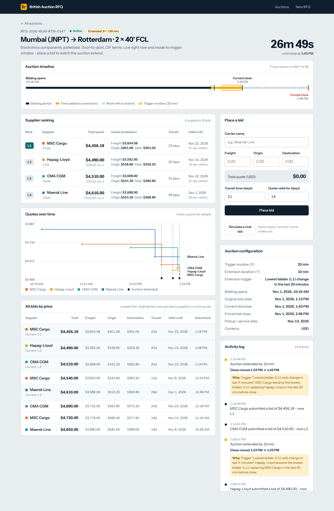
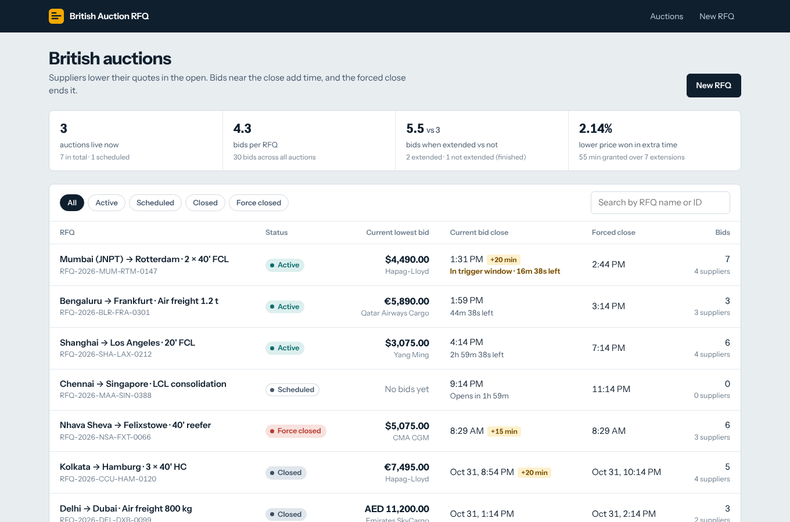
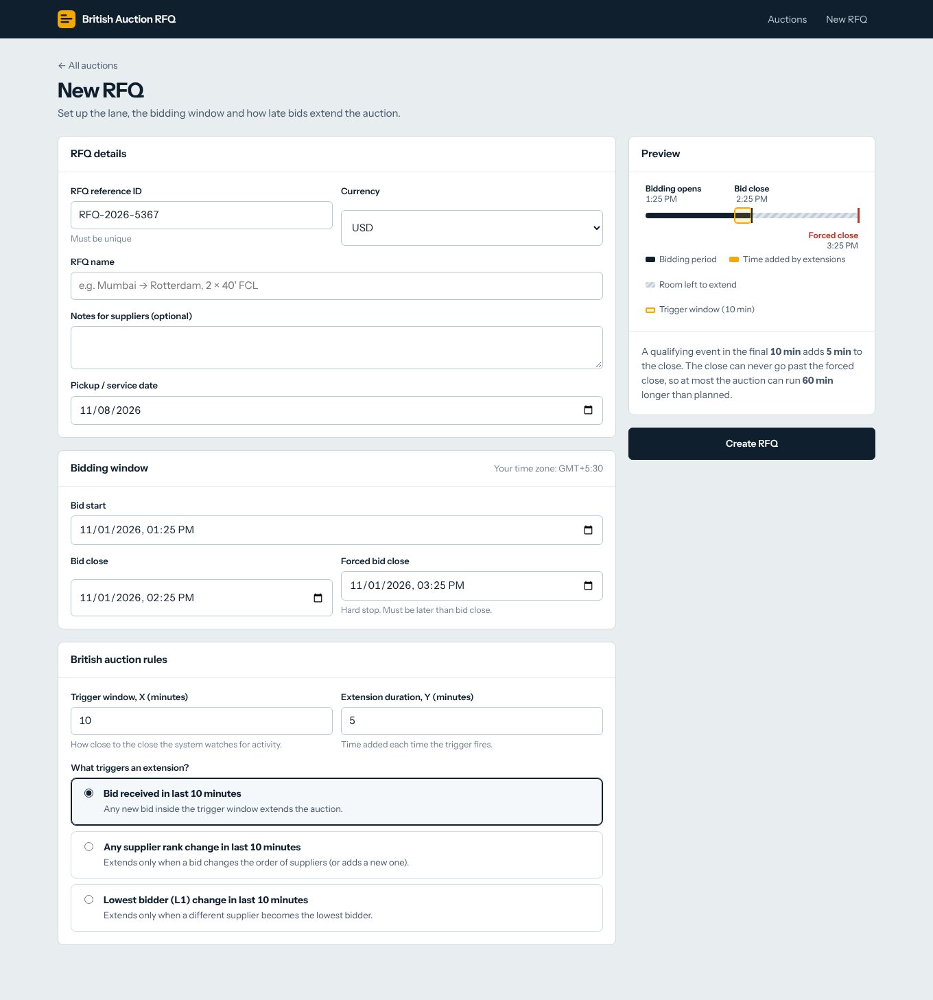

# British Auction RFQ

An RFQ (Request for Quotation) platform where carriers compete in a **British auction**: quotes are open, each supplier can only
lower its own price, **bids near the close automatically extend the auction**, and a **Forced Bid Close** is a hard ceiling that
no extension can cross.

[](https://github.com/abhishekisagemai-bot/britishrfq/actions)



<table>
<tr>
<td width="50%"></td>
<td width="50%"></td>
</tr>
</table>

## Run it

Requires **Node 22.13+** (uses the built-in `node:sqlite`, so there is no native build step).

```bash
npm install
npm run dev          # API on :8080, web on http://localhost:5173  (seeds 7 demo auctions)
```

```bash
npm test             # 39 backend + 4 frontend tests
npm run build && npm start   # single process: API + built UI on http://localhost:8080
docker compose up --build    # same, containerised, data persisted in a volume
npm run seed         # reset the demo data
```

**Try the headline behaviour in 20 seconds:** open the live auction *Mumbai (JNPT) → Rotterdam* (it is inside its trigger window),
click **Simulate a rival bid** (or submit your own lower quote) and watch the clock jump by Y minutes, the timeline strip grow, and the
activity log record *why*.

## Deliverables

| Required (spec §9) | Where |
|---|---|
| Simple HLD with architecture diagram | [`docs/HLD.md`](docs/HLD.md) - architecture, bid sequence, extension decision tree, lifecycle, trade-offs, scaling path |
| Schema design for database tables | [`docs/SCHEMA.md`](docs/SCHEMA.md) + [`backend/db/schema.sql`](backend/db/schema.sql) (ER diagram, constraints, indexes) |
| Backend code | [`backend/`](backend) - Node 22, TypeScript, Express 5, SQLite |
| Frontend code | [`frontend/`](frontend) - React 18, TypeScript, Vite |
| (bonus) API reference | [`docs/API.md`](docs/API.md) |

## Requirement traceability - every line of the brief

| Spec | Requirement | Implementation | Verified by |
|---|---|---|---|
| §5 | Create RFQ with British Auction enabled | `POST /api/auctions`, `pages/Create.tsx` | `http.test` create flow |
| §5 | RFQ Name / Reference ID, Bid Start, Bid Close, **Forced Bid Close**, Pickup / Service date | `createSchema` (`domain/validation.ts`), form fields | `service.test` validation |
| §5 | Quote form: Carrier, Freight, Origin, Destination charges, Transit time, Quote validity | `bidSchema`, `components/BidForm.tsx` (live total) | `service.test` ranking, `http.test` |
| §5 | **Never extend beyond Forced Bid Close** | `min(close+Y, forced)` in `domain/extension.ts` + DB `CHECK (bid_close_ms <= forced_close_ms)` | property test over 200 inputs; chained-extension test |
| §6.1 | Trigger window X (monitor `[close-X, close)`) | `evalExtension` | boundary tests: 5:50 in, 5:49:59.999 out, 6:00 out |
| §6.2 | Extension duration Y (6:00 → 6:05) | adds Y to the **current close** | spec example test |
| §6.3a | Trigger: bid received in last X min | `BID_RECEIVED` | 5:55 PM → 6:05 PM test |
| §6.3b | Trigger: any supplier rank change in last X min | `ANY_RANK_CHANGE` (`rankChanged`) | reorder extends; price-drop-without-reorder doesn't |
| §6.3c | Trigger: L1 change in last X min | `L1_CHANGE` (`l1Changed`) | new L1 extends; non-L1 move doesn't |
| §7 | Forced close > bid close | zod + `timelineErrors` (server), `lib/validate.ts` (client), DB `CHECK` | domain + service + frontend tests |
| §7 | Extensions never exceed forced close | as above, plus `CAPPED` / `BLOCKED` outcomes are logged | `service.test` 18:12 scenario |
| §8 | Listing: name/ID, **current lowest bid**, **current bid close**, **forced close**, status (Active / Closed / Force Closed) | `GET /api/auctions`, `pages/Listing.tsx` (+ Scheduled, filters, search, live countdown) | `http.test` list |
| §8 | Details: **all bids sorted by price**, **ranking L1, L2, L3…**, quote details (charges, validity), **config (X, Y)** | `GET /api/auctions/:ref`, `pages/Details.tsx` | `service.test` ranking |
| §8 | Activity log: bid submissions, time extensions, **reason for each extension** | `activity_log`, `components/Activity.tsx` | reason text asserted per trigger |
| §4 | Success metrics: bids per RFQ, price improvement vs non-extended | `GET /api/metrics`, insights strip on the listing | `service.test` metrics |

## Design decisions the brief left open

* **Force Closed vs Closed.** An auction is *Force Closed* when it ends with `close == forced close` (extensions ran into the ceiling), otherwise *Closed*.
  Refused extension attempts are additionally logged as `EXTENSION_BLOCKED`.
* **Extension adds Y to the current close**, not to the bid time (the spec's 6:00 → 6:05 example). One qualifying bid = one extension.
* **Window boundaries:** `[close − X, close)`. A bid at exactly the close is rejected.
* **"Rank change" (b)** = the ordered list of suppliers changed (someone moved up, or a new supplier entered). A price drop that keeps everyone's position is *not* a rank change - that's what separates (b) from (a).
* **"L1 change" (c)** = a different supplier is now lowest. The **first bid** of an auction counts (nobody → someone).
* **Only lower bids:** a supplier's new total must be strictly below its own previous total (`BID_NOT_LOWER`). Ties between suppliers: earlier bid ranks higher.
* **Server time only.** The server timestamps every bid; the UI countdown is corrected by the server clock so a wrong laptop clock cannot mislead a bidder.
* **Auth is out of scope** (the brief has none): carriers are identified by name; the design notes how to bind them to users.

## Engineering highlights

* Rules are **pure functions** (`ranking`, `extension`, `status`, `validation`) driven by an injected clock - tested to the millisecond without sleeping.
* Each bid is one **`BEGIN IMMEDIATE` transaction** (validate → insert → re-rank → evaluate trigger → extend → log); rejected bids leave no trace.
* Money is **integer cents**; `total_cents` is a generated column; ranking is **derived**, never stored.
* **Live UI** over Server-Sent Events with a polling fallback; trigger-window banner, countdown and timeline strip update without refresh.
* Hardening: zod on every input, helmet, rate-limited writes, parameterised SQL, consistent error envelope, no stack traces to clients.
* Demo seed builds *real history through the real code path* with a fake clock (including a force-closed auction with capped and blocked extensions).

## Project layout

```
backend/   src/domain (pure rules) · src/service.ts · src/http · db/schema.sql · test/
frontend/  src/pages · src/components (Timeline, PriceChart, Leaderboard, BidForm, Activity) · src/lib
docs/      HLD.md · SCHEMA.md · API.md · img/ · screenshots/
```

Configuration (env): `PORT` (8080), `DB_PATH` (`backend/data/rfq.db`), `ENABLE_DEMO` (`1` shows the "Simulate a rival bid" helper and seeds an empty DB; default on outside production), `WEB_DIR`.

## License

MIT
