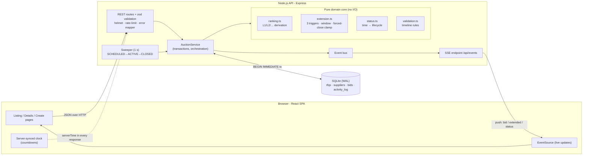
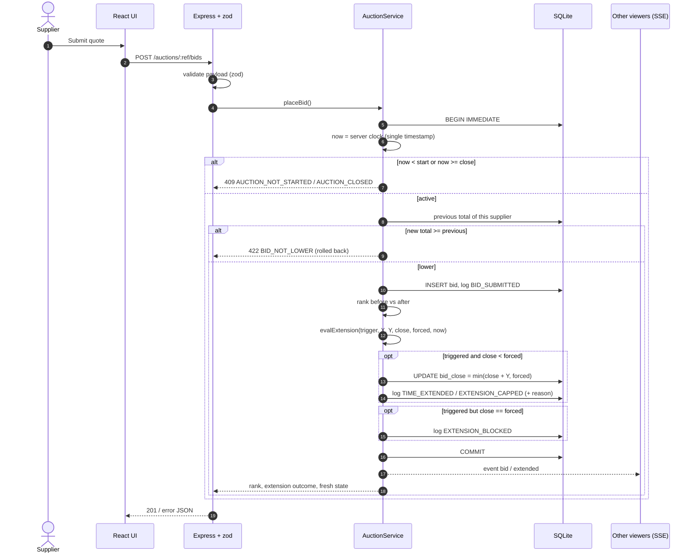
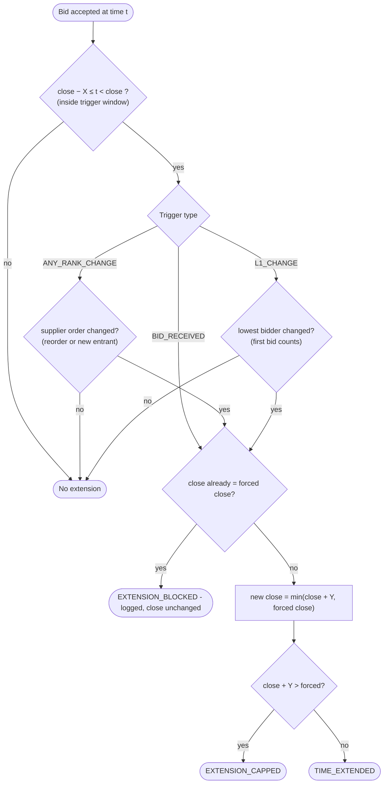
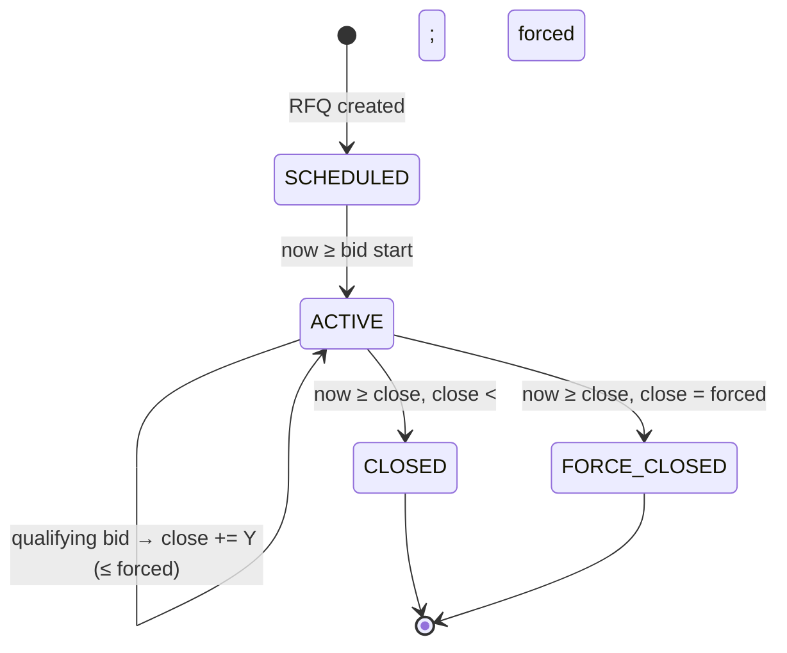

# High-Level Design

## 1. Context & goals

Buyers publish an **RFQ**; carriers (suppliers) compete in a **British auction**: quotes are open, each
supplier may only *lower* its own price, **late activity extends the clock**, and a **forced close** is a hard
ceiling. The system must make that behaviour correct, configurable and visible.

| Business goal (spec §3) | How the design delivers it |
|---|---|
| Transparent, fair competition | Open leaderboard (L1, L2, …), append-only bid history, full activity log with a reason for every extension |
| Prevent last-minute manipulation | Trigger window + extension: a late bid / re-rank / new leader buys everyone more time |
| Encourage participation | Live updates (SSE), "inside trigger window" prompts, clear rank + gap to L1 |
| Better final prices | Metrics page compares extended vs non-extended auctions (bids/RFQ, price improvement) |

## 2. Architecture

**Why this shape**

* **Pure domain core.** Everything that decides *money and time* (ranking, trigger evaluation, forced-close clamp, status) is a pure
  function of `(state, now)`. That makes the rules unit-testable to the millisecond with an injected clock - no sleeping, no mocks.
* **One server clock.** Only the server timestamps a bid. The browser never decides whether a bid was "in time"; it just
  displays a countdown corrected by the server's time (`serverTime` is on every response), so a skewed laptop clock can't mislead.
* **Atomic bids.** A bid is *validate → insert → rank before/after → evaluate trigger → extend → log* inside one
  `BEGIN IMMEDIATE` transaction. Two bids at the same instant serialise on the write lock; a rejected bid leaves no trace.
* **Derived ranking.** L1/L2/… is computed from bids, never stored, so it cannot drift out of sync.
* **Push, not poll.** State changes are broadcast over SSE; the UI refetches the one affected RFQ. A slow poll is a safety net.

## 3. The bid pipeline

### Extension decision (spec §6)

### Auction lifecycle

## 4. Key decisions & trade-offs

| Decision | Rationale | Alternative considered |
|---|---|---|
| Status is a pure function of time, persisted lazily by a 1 s sweeper **and** on every read/bid | Never stale even if the sweeper stalls; logs carry the *logical* time (e.g. 6:00 PM) | Cron-only close (can lag, can accept a late bid) |
| `Force closed` = ended with `close == forced close` | Unambiguous and derivable; blocked extension attempts are separately logged | Flag set only when an extension was refused |
| Extension adds Y to the **current close** (6:00 → 6:05), not to "now" | Exactly the spec example; predictable for suppliers | `now + Y` |
| Window is `[close−X, close)`; a bid at exactly `close` is rejected | No ambiguity at the boundary | Inclusive end |
| Supplier may only bid **lower than its own previous total** | British-auction semantics ("continuously lower their prices"); guarantees latest = best | Allow any bid |
| Equal prices: earlier bid ranks higher | Rewards early commitment; deterministic | Share rank |
| Money in integer cents | No float drift when summing charges | DECIMAL / float |
| Instants as epoch-ms integers | Exact CHECK constraints; timezone-proof | ISO strings |
| SQLite (WAL) | Zero-ops, ACID, single-writer fits "serialise bids per RFQ" | See §6 |

## 5. Non-functional

* **Correctness under concurrency:** single-writer IMMEDIATE transactions; DB `CHECK` constraints are a second line of defence
  (`forced_close > orig_close`, `orig_close ≤ close ≤ forced_close`).
* **Security:** helmet headers, JSON size cap, per-IP rate limit on writes, zod on every input, parameterised SQL only, no stack traces to clients.
* **Observability:** every business event is in `activity_log` (immutable), structured error codes in API responses.
* **Testability:** injected clock; 39 backend + 4 frontend tests incl. the spec's worked examples.
* **Accessibility:** keyboard focus rings, `role="alert"` on errors, `aria-live` toasts, reduced-motion respected, colour never the only carrier of meaning.

## 6. Scaling path (out of scope for the assignment, designed for)

1. **Postgres** instead of SQLite: schema ports 1:1 (`BIGINT` instants, `NUMERIC`/`BIGINT` cents). Bid serialisation becomes
   `SELECT … FROM rfqs WHERE id=$1 FOR UPDATE`; `total_cents` stays a generated column.
2. **Horizontal API scale:** the service is stateless; replace the in-process event bus with Postgres `LISTEN/NOTIFY` or Redis pub/sub for SSE fan-out.
3. **Sweeper → job queue** (one delayed job per `bid_close`, re-scheduled on extension) to avoid scanning.
4. **Auth & tenancy:** buyer/supplier roles, supplier identity bound to a user instead of a typed carrier name; per-org RFQ visibility.
5. **Notifications:** outbid / extended / closing-soon e-mail & webhooks fed from the same event bus.
