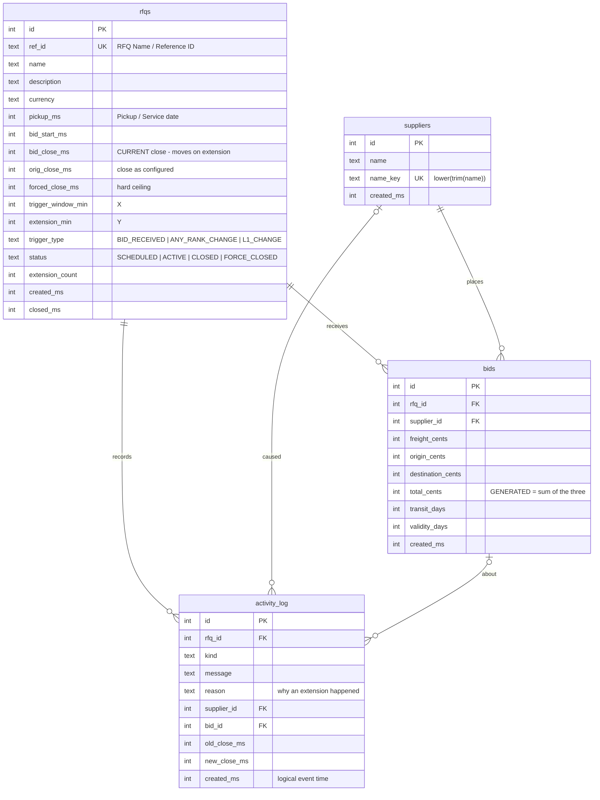

# Database schema

Source of truth: [`backend/db/schema.sql`](../backend/db/schema.sql) (applied automatically on start).

## Tables

| Table | Purpose | Notes |
|---|---|---|
| `rfqs` | One row per RFQ / auction incl. its British-auction configuration (X, Y, trigger) | `bid_close_ms` is the live close; `orig_close_ms` is kept so the UI can show how much time extensions added |
| `suppliers` | Bidder identity (carrier) | Unique on normalised name, so "Maersk  LINE" = "maersk line" |
| `bids` | Append-only quote submissions | `total_cents` is a **generated stored column** - can never disagree with its parts |
| `activity_log` | Immutable audit trail: bids, extensions (with reason), caps, blocked attempts, start/close | `created_ms` is the *logical* time, so a close at 6:00 PM reads 6:00 PM even if processed later |

## Integrity rules enforced **in the database**

| Rule (spec §7) | Constraint |
|---|---|
| Forced close must be later than bid close | `CHECK (forced_close_ms > orig_close_ms)` |
| An extension never goes beyond forced close | `CHECK (bid_close_ms >= orig_close_ms AND bid_close_ms <= forced_close_ms)` |
| Bidding period is positive | `CHECK (bid_close_ms > bid_start_ms)` |
| X and Y are positive | `CHECK (trigger_window_min > 0)`, `CHECK (extension_min > 0)` |
| Valid trigger / status values | `CHECK (... IN (...))` |
| Non-negative charges, positive total, sane transit / validity | `CHECK` on `bids` |
| Unique RFQ reference (case-insensitive) | `ref_id TEXT UNIQUE COLLATE NOCASE` |

## Indexes

| Index | Serves |
|---|---|
| `idx_bids_rfq_total (rfq_id, total_cents, created_ms)` | leaderboard / lowest-bid lookups |
| `idx_bids_rfq_sup (rfq_id, supplier_id, created_ms)` | "this supplier's previous bid" check |
| `idx_log_rfq (rfq_id, created_ms, id)` | activity log in order |
| `idx_rfqs_status (status, bid_close_ms)` | sweeper & listing filters |

## Ranking is derived, not stored

`L1, L2, …` = suppliers ordered by each supplier's best bid (`total_cents` asc, then earlier `created_ms`, then `id`).
Storing it would create a second source of truth that could go stale between a bid and its re-rank.
